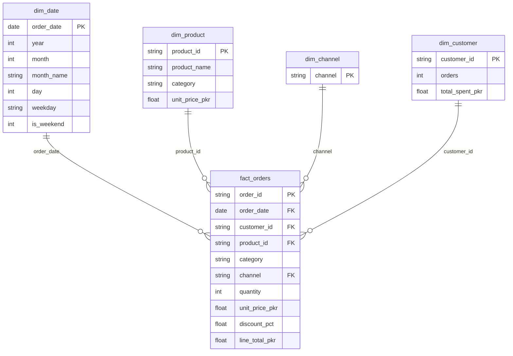
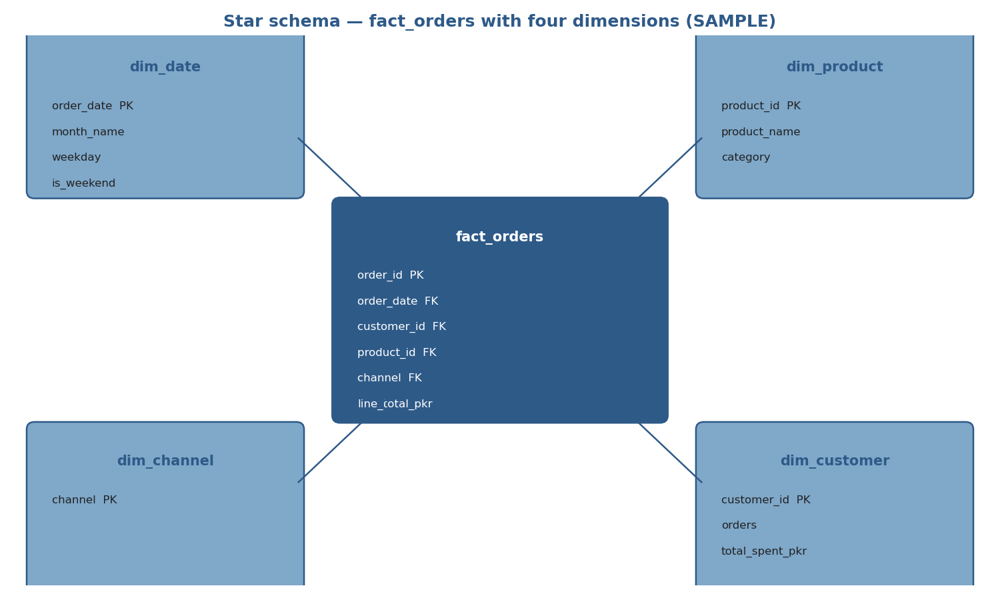

# Power BI model — P28 Automated Pipeline + Power BI Dashboard Pack

The model the `.pbix` is built from. Tables are the gold marts and
dimensions the pipeline writes — import the CSVs in
`data/processed/` and `outputs/` (or connect the SQLite warehouse
`data/processed/pipeline.db` directly; the CSVs are the portable
route). All money is PKR. SAMPLE data: 30 days, 25 Oct – 23 Nov
2026, 2,094 orders, PKR 38,573,539.50.

## Tables

| Table | Source file | Rows | Grain |
|---|---|---|---|
| `fact_orders` | `data/processed/fact_orders.csv` | 2,094 | One row per order |
| `dim_date` | built from `mart_sales_by_day.csv` dates | 30 | One row per day |
| `dim_product` | `outputs/mart_top_products.csv` + fact | 24 | One row per product |
| `dim_channel` | `outputs/mart_sales_by_channel.csv` | 3 | One row per channel |
| `dim_customer` | built from `fact_orders.csv` | 240 | One row per customer |
| `mart_sales_by_day` | `outputs/mart_sales_by_day.csv` | 30 | One row per day (pre-aggregated) |
| `mart_sales_by_channel` | `outputs/mart_sales_by_channel.csv` | 3 | One row per channel |
| `mart_sales_by_category` | `outputs/mart_sales_by_category.csv` | 4 | One row per category |
| `mart_top_products` | `outputs/mart_top_products.csv` | 10 | Top 10 products by revenue |

`dim_date`, `dim_product` and `dim_customer` are exported from the
warehouse with the build script below — they are not separate CSVs
in the repo because the fact table already carries their keys; the
build guide (step 1) shows how to derive them in Power Query in
under a minute, or export them from SQLite:

```sql
-- dim_date
SELECT order_date, year, month, month_name, day, weekday, is_weekend
FROM dim_date ORDER BY order_date;
-- dim_product
SELECT product_id, product_name, category, unit_price_pkr
FROM dim_product ORDER BY product_id;
-- dim_customer
SELECT customer_id, orders, total_spent_pkr
FROM dim_customer ORDER BY customer_id;
```

## Relationships (Model view, all single-direction, one-to-many)

- `dim_date[order_date]` → `fact_orders[order_date]`
- `dim_product[product_id]` → `fact_orders[product_id]`
- `dim_channel[channel]` → `fact_orders[channel]`
- `dim_customer[customer_id]` → `fact_orders[customer_id]`

One fact table, four dimensions — that star shape is why every
visual agrees on the same totals. The marts are imported as
standalone reference tables for the pre-aggregated visuals; they do
not join to the fact (their totals are already the fact's totals —
see `sql/tests/t14`).

## Star schema





> The diagram above is also rendered as `powerbi/model_star_schema.png`
> (matplotlib), so the model reads without a Mermaid renderer.

## Measures

12 measures in `dax_measures.md` — paste them into the `.pbix`
(Modeling → New measure). They cover the KPI cards (Total Revenue,
Total Orders, AOV), the trend (Revenue vs Prior Period, Revenue
Growth %), the mix (channel/category share, top category/product)
and the guardrails (orders per day, quarantine check).

## Pages (4)

1. **Overview** — KPI cards + daily revenue bars with 7-day moving average.
2. **Sales by channel** — revenue-share donut + orders by channel.
3. **Top products** — top 10 products by revenue + category mix.
4. **Daily trend** — daily orders and revenue, weekends shaded.

Preview renders of all four pages are in `powerbi/previews/` —
matplotlib renders of the same data, labelled as renders, not
Power BI screenshots. The real screenshots come from the `.pbix`
built with `powerbi/build_guide.md`.
